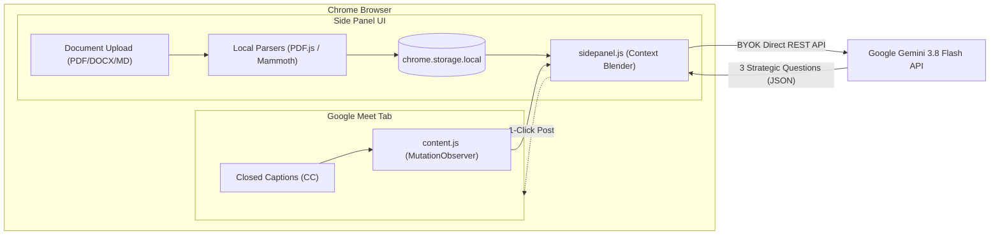

<div align="center">

# 🎙️ Meet Wingman AI
### *Your private, real-time AI copilot for Google Meet.*

[](https://developer.chrome.com/docs/extensions/mv3/intro/)
[](https://ai.google.dev/)
[](https://developer.chrome.com/docs/extensions/reference/sidePanel/)
[](#-privacy--security)
[](LICENSE)

<br/>

**Meet Wingman AI** is a lightweight, distraction-free Chrome extension that listens to Google Meet calls in real time via native closed captions, cross-references spoken dialogue with your reference documents (PRDs, tech specs, sprint plans, agendas), and generates sharp, high-impact questions to help you lead the conversation.

**No awkward bots joining the call. No audio recording. No expensive monthly subscriptions. 100% client-side.**

---

</div>

## 💡 The Problem & The Solution

| Traditional Meeting AI Bots (Otter, Fireflies, etc.) | Meet Wingman AI |
| :--- | :--- |
| ❌ Awkward third-party bot joins the call and records everyone | ✅ **Zero bots.** Operates invisibly in your Chrome Side Panel |
| ❌ Expensive STT (Speech-to-Text) cloud pipelines & subscriptions | ✅ **Free & fast.** Uses Google Meet's native closed captions |
| ❌ Only gives passive summaries *after* the meeting ends | ✅ **Real-time steering.** Gives you questions *while* the call happens |
| ❌ No context on what you actually planned to achieve | ✅ **Context-blended.** Cross-references live speech against your PRD/spec |
| ❌ Third-party cloud servers store company audio | ✅ **100% client-side.** Direct calls to Google Gemini via your own API key |

---

## ✨ Features

- 📄 **Pre-Meeting Document Ingestion (Offline & Client-Side)**:
  - Drag-and-drop `.pdf`, `.docx`, `.md`, `.txt`, `.json`, or `.csv` files before joining.
  - Fully parsed inside your browser using bundled **Mozilla PDF.js** and **Mammoth.js**.
  - Persisted in local browser storage so your context is ready before you click "Join".
- 🎙️ **Live Captions Listener**:
  - Scrapes Google Meet closed captions (`CC`) in real time with zero audio streaming lag.
  - Smart speaker attribution: recognizes individual speakers and isolates your turns.
  - In-place deduplication: eliminates repeated sentences as Google Meet progressively accumulates speech.
  - Automatically filters out Meet system toasts (*"Your camera is on"*, *"Live captions are on"*).
- 🧠 **Context Blending with Google Gemini 3.8 Flash**:
  - Compares the rolling transcript of recent dialogue against your uploaded reference document.
  - Leverages Gemini's **1M+ token context window** to digest extensive 50+ page PRDs without truncation.
- 🎯 **3 Strategic Question Categories**:
  - **Steer**: Re-anchors the room to core goals, deliverables, and timelines when discussions go off-track.
  - **Blindspot (Gap)**: Identifies contradictions, unaddressed requirements, or edge-case risks between the document and spoken dialogue.
  - **Deepen**: Probes for concrete technical architecture, implementation specifics, and execution clarity.
- 💬 **One-Click Actions**:
  - **Send to Meet Chat**: Pastes the question directly into Google Meet's live in-call chat box.
  - **Copy to Clipboard**: Instant copy with visual feedback.
  - **Export Transcript**: Download clean Markdown logs of the discussion with timestamps and speaker labels.
- ⚡ **Auto-Suggest Mode**:
  - Turn on autopilot to automatically analyze dialogue and refresh strategic questions as the conversation progresses.
- 👤 **Customizable Personas**:
  - Tailor suggestions for your exact role: **Product Manager**, **Tech Lead / Architect**, **Engineering Manager**, **Sales / Client Lead**, or **Executive / VP**.

---

## 🏗️ Architecture



---

## 🚀 Quick Start & Installation

You can run Meet Wingman AI locally in less than 60 seconds:

### 1. Clone or Download

```bash
git clone https://github.com/YOUR_USERNAME/meet-wingman-ai.git
```
*(Or download the repository as a `.zip` and extract it).*

### 2. Load into Google Chrome

1. Open Chrome and go to `chrome://extensions/`.
2. Toggle on **Developer mode** in the top-right corner.
3. Click **Load unpacked** in the top-left corner.
4. Select the `Meet-wingman` folder.
5. Pin **Meet Wingman AI** to your Chrome extensions toolbar!

### 3. Add Your Gemini API Key

1. Get a free API key from [Google AI Studio](https://aistudio.google.com/app/apikey).
2. Click the **Meet Wingman AI** extension icon to open the Side Panel.
3. Click ⚙️ **Settings** (top right of the side panel).
4. Paste your API key, choose your preferred model (`gemini-3.8-flash` recommended), and click **Save**.

---

## 🎬 How to Use During a Meeting

1. **Before the Call**:
   - Open the side panel.
   - Drop your PRD, architecture spec, or meeting notes into **Reference Document & Notes**.
   - Select your persona (e.g. *Product Manager* or *Tech Lead*).
2. **In Google Meet**:
   - Join your call at `meet.google.com`.
   - **Turn on Closed Captions (CC)** by pressing `c` on your keyboard or clicking the **[CC]** button.
   - The status banner in the side panel will turn green: `Listening to Meet captions`.
3. **During the Discussion**:
   - Spoken dialogue appears cleanly in the transcript feed.
   - Click **Generate Questions** (or enable **Auto-suggest**) to receive 3 targeted questions based on what people are actually saying vs. what was planned.
   - Click **Send to Chat** to paste any question into Google Meet's chat, or speak it aloud!

---

## 🔒 Privacy & Security

Meet Wingman AI was built strictly on **privacy-first, local-first principles**:

- **No Middleman Servers**: There is zero backend infrastructure or telemetry. Everything runs locally in your browser.
- **Client-Side Document Parsing**: All PDF and Word parsing occurs offline in your browser using bundled WebAssembly/JS libraries.
- **Direct LLM Communication**: API requests travel directly from your browser to Google's official Gemini endpoint (`generativelanguage.googleapis.com`) using your personal API key.
- **Secure Local Storage**: Your API key, uploaded document, and transcripts never leave your machine; they are kept in sandboxed `chrome.storage.local`.

---

## 📂 Project Structure

```text
meet-wingman/
├── manifest.json       # Chrome Extension Manifest V3 configuration
├── background.js       # Background service worker (Side Panel routing)
├── content.js          # Google Meet captions observer & DOM scraper
├── sidepanel.html      # Side panel interface
├── sidepanel.js        # Document parser, transcript deduplicator & Gemini integration
├── styles.css          # Minimal, dark-mode utilitarian stylesheet
├── lib/                # 100% offline client-side parsers
│   ├── pdf.min.js
│   ├── pdf.worker.min.js
│   └── mammoth.browser.min.js
└── icons/              # Extension icons (16px, 48px, 128px)
```

---

## 🤝 Contributing

Contributions, feedback, and feature requests are welcome!
1. Fork the Project.
2. Create your Feature Branch (`git checkout -b feature/AmazingFeature`).
3. Commit your Changes (`git commit -m 'Add some AmazingFeature'`).
4. Push to the Branch (`git push origin feature/AmazingFeature`).
5. Open a Pull Request.

---

## 📄 License

Distributed under the MIT License. See `LICENSE` for more information.
